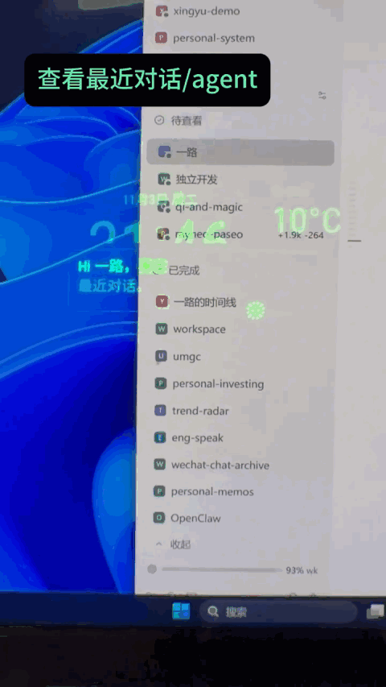
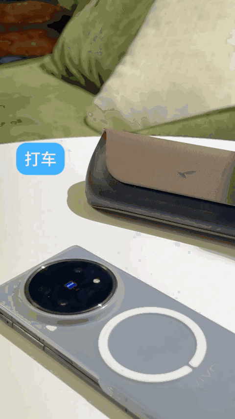
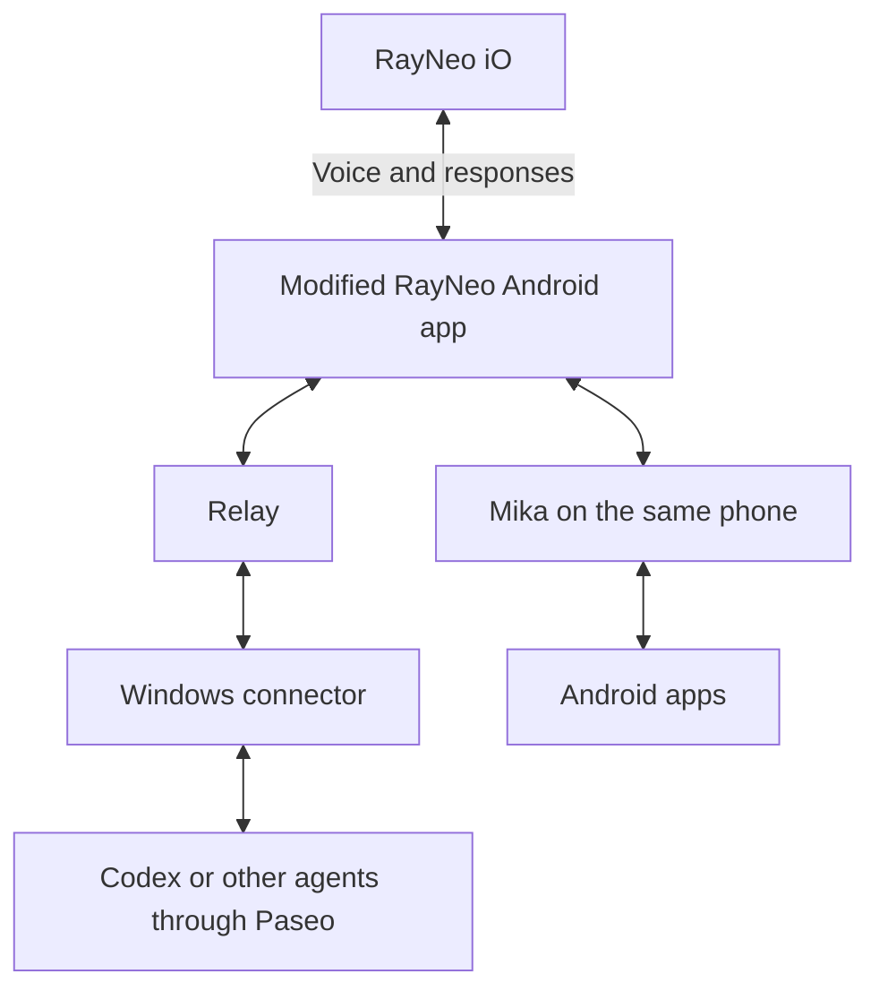

# IO Voice Control

**Control your computer and phone by voice with RayNeo iO.**

Put on the glasses, say what you want to do, and see the result in the lenses. On Windows, connect to Codex or Paseo. On Android, use Mika to carry out tasks. The project modifies the Android app and leaves the glasses firmware unchanged.

**English** &nbsp; [简体中文](README.zh-CN.md)

[Get started](#get-started) &nbsp; [Get a test code](docs/en/connect-computer.md#use-the-hosted-relay) &nbsp; [Releases](https://github.com/turbotang2333/io-voice-control/releases)

## See it in action

<table>
<tr>
<td width="50%" align="center" valign="top"><strong>Hands-free computer control</strong>  Find and select a computer conversation by voice.</td>
<td width="50%" align="center" valign="top"><strong>Hands-free phone control</strong>  Give the phone a ride-hailing task through the glasses.</td>
</tr>
</table>

[Watch the full demo](https://xhslink.cn/o/1ULZbJJtYeJ)

## What you can do

<table>
<tr>
<th width="50%" align="left">Hands-free computer control</th>
<th width="50%" align="left">Hands-free phone control</th>
</tr>
<tr>
<td valign="top">

Connect directly to Codex or use <a href="https://github.com/getpaseo/paseo">Paseo</a> to reach agents such as Claude Code and OpenCode.

<ul>
<li>List recent conversations or search for one.</li>
<li>Choose a project and conversation, then give the agent a task.</li>
<li>Page through long replies in the glasses.</li>
<li>Set up shortcuts for actions you use often.</li>
<li>End a conversation by voice.</li>
</ul>

Claude Code and OpenCode use the Paseo integration. Support for individual agents is still being tested.

</td>
<td valign="top">

Describe a task to <a href="https://github.com/wangzan101/Mika">Mika</a> in your own words. Mika operates Android apps and reports back. You can follow up or start a new task.

The connection to Mika has been checked. Phone task execution still needs testing with the release build.

</td>
</tr>
</table>

## Get started

### 1. Prepare your devices

You'll need RayNeo iO glasses and an Android phone with the modified RayNeo app.

| Software | Install on | Version | Download |
| --- | --- | --- | --- |
| Modified RayNeo app | Android phone | Based on the official Android app v1.0.25 | [Project releases](https://github.com/turbotang2333/io-voice-control/releases) |

> The modified and official RayNeo apps use different signatures. You may need to uninstall the official app before installing the modified version. Back up any local data you want to keep. For future updates, download an APK signed with the same project release key and follow the release notes.

### 2. Choose what to control

| What to control by voice | Supported device | What to install | Download |
| --- | --- | --- | --- |
| Computer | Windows PC | RayNeo iO Connector, plus the Codex desktop app or Paseo. Paseo can connect to Codex, Claude Code, and OpenCode. | [Windows connector releases](https://github.com/turbotang2333/io-voice-control/releases) [Paseo releases](https://github.com/getpaseo/paseo/releases) |
| Phone | Android phone | Mika | [Mika releases](https://github.com/wangzan101/Mika/releases) |

iPhone and macOS are currently unsupported.

### 3. Connect and start using it

<table>
<thead><tr><th></th><th width="45%">Computer</th><th width="45%">Phone</th></tr></thead>
<tbody>
<tr>
<th scope="row">Connect</th>
<td valign="top"><ol><li>Open Codex and sign in, or start Paseo with your chosen agent.</li><li>Open RayNeo iO Connector and choose the hosted relay or your own server.</li><li>In the RayNeo app, open <strong>Assistant settings → Scan to pair with a computer</strong> (助手设置 → 扫码配对电脑). Scan the QR code from the connector and confirm.</li></ol></td>
<td valign="top"><ol><li>In Mika, open <strong>Connect a computer</strong>, enable network access, and copy the access token.</li><li>In the RayNeo app's <strong>Assistant settings</strong> (助手设置), choose Mika. Enter the token and local port (default <code>8765</code>), save, then select <strong>Check connection</strong> (检查连接).</li></ol></td>
</tr>
<tr>
<th scope="row">Setup notes</th>
<td valign="top">
<strong>Use the hosted relay.</strong> Get a test code by <a href="https://www.xiaohongshu.com/user/profile/5d483e2b00000000120086a2">direct message on Xiaohongshu</a> or <a href="mailto:turbotang2333@gmail.com">email (turbotang2333@gmail.com)</a>.

<strong>Host your own relay.</strong> Use the computer guide for server requirements, ports, and installation steps.
</td>
<td valign="top">If you changed the port in Mika, enter the port Mika displays.</td>
</tr>
</tbody>
</table>

[Connect a computer agent](docs/en/connect-computer.md) &nbsp; [Connect Mika](docs/en/connect-mika.md)

This release passed an initial check on an existing Windows setup. The tester updated the connector, paired the phone, and confirmed seeing one assistant reply in the glasses.

## How it works

The project modifies the RayNeo Android app so it can connect to a computer agent or a phone agent. The glasses keep their original firmware.

The computer agent connects through the relay and the Windows connector. Mika operates apps on the phone. In both cases, you give commands and see responses through the glasses.

The relay forwards data between the phone and computer. The live configuration and log retention of the hosted relay still need verification. See [Privacy and data handling](docs/en/privacy.md).

## Roadmap

- Make it easier to switch between the computer and phone from the glasses.
- Use natural language to understand what you want to do and coordinate tasks across both devices. A separate agent to handle that coordination is still an idea.

Ideas, feedback, and contributions are welcome. [GitHub Issues](https://github.com/turbotang2333/io-voice-control/issues)

## Credits and license

Thanks to [Paseo](https://github.com/getpaseo/paseo), [Mika](https://github.com/wangzan101/Mika), and the other open-source projects that make this possible.

The Android voice callback wrappers draw on [Turbo-IO](https://github.com/Turbo1123/Turbo-IO/tree/f983669a2db1c2a658f7d4c50285b81aa074345a). The code that copies Android reply objects is adapted from its implementation. [OpenRayneo](https://github.com/Tobi1chi/OpenRayneo/blob/7f2fc0dbb4414fa66bdc5a1be23d44b7d4b4ec31/Sources/OpenRayneoBridge/main.swift) was a research reference for the teleprompter display and transfer protocol.

The original project code uses the [MIT license](LICENSE). The code adapted from Turbo-IO is subject to the [PolyForm Noncommercial License 1.0.0](https://github.com/Turbo1123/Turbo-IO/blob/f983669a2db1c2a658f7d4c50285b81aa074345a/LICENSE) and the [upstream notice](https://github.com/Turbo1123/Turbo-IO/blob/f983669a2db1c2a658f7d4c50285b81aa074345a/NOTICE). The RayNeo app, firmware, and other third-party components remain subject to their own terms. See [Third-party notices (Chinese)](THIRD_PARTY_NOTICES.md).
