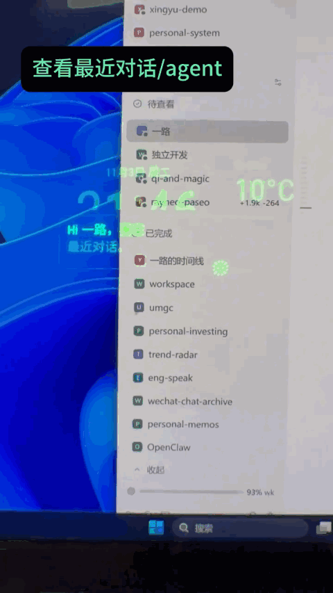
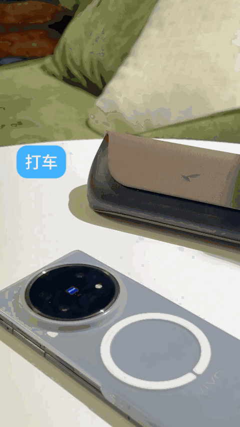
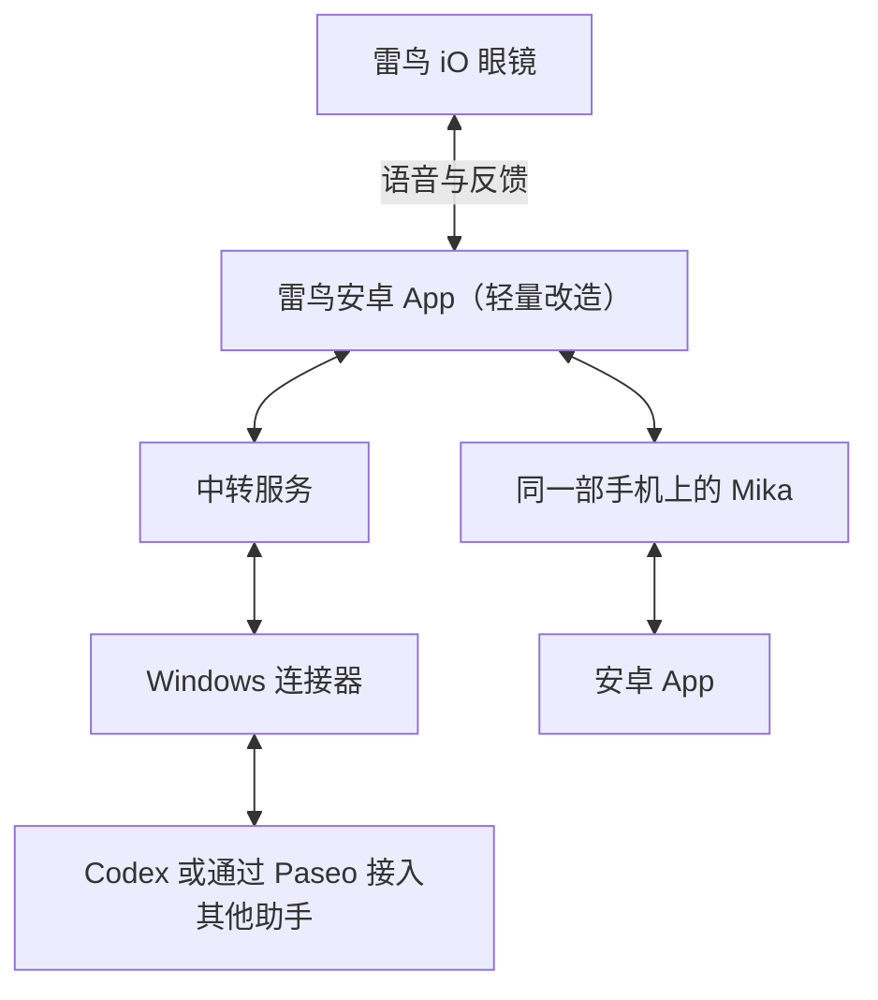

# IO Voice Control

**用雷鸟 iO 全语音操控电脑和手机。**

戴上眼镜，说出任务，在镜片上查看结果。Windows 电脑可以接入 Codex 或 Paseo，安卓手机可以通过 Mika 执行任务。项目在安卓 App 上做改造，眼镜固件保持原样。

[English](README.md) &nbsp; **简体中文**

[怎么开始](#怎么开始) &nbsp; [获取测试码](docs/connect-computer.md#使用作者中转) &nbsp; [项目发行页](https://github.com/turbotang2333/io-voice-control/releases)

## 操作演示

<table>
<tr>
<td width="50%" align="center" valign="top"><strong>全语音操控电脑（Codex 等 AI 助手）</strong>  语音查看并选择电脑对话。</td>
<td width="50%" align="center" valign="top"><strong>全语音操控手机</strong>  通过眼镜下达打车指令，手机执行任务。</td>
</tr>
</table>

[观看完整演示](https://xhslink.cn/o/1ULZbJJtYeJ)

## 能做什么

<table>
<tr>
<th width="50%" align="left">全语音操控电脑</th>
<th width="50%" align="left">全语音操控手机</th>
</tr>
<tr>
<td valign="top">

项目可以直接连接电脑上的 Codex，也可以通过开源项目 <a href="https://github.com/getpaseo/paseo">Paseo</a> 接入 Claude Code、OpenCode 等助手。

<ul>
<li>列出最近对话，或查找对话。</li>
<li>选择项目和对话，向助手发送任务。</li>
<li>在眼镜上翻页查看较长的回复。</li>
<li>设置自定义快捷入口。</li>
<li>通过语音结束对话。</li>
</ul>

Claude Code、OpenCode 等助手通过 Paseo 接入，具体支持范围仍待验证。

</td>
<td valign="top">

项目将改造版雷鸟 App 与 <a href="https://github.com/wangzan101/Mika">Mika</a> 连接起来。你可以通过眼镜用自然语言交代任务，由 Mika 操作安卓 App。

收到反馈后，可以继续补充指令，也可以开始新任务。

Mika 已完成连接检查，实际手机任务仍待验收。

</td>
</tr>
</table>

## 怎么开始

### 1. 准备设备

一副雷鸟 iO 眼镜，以及一部安装了改造版雷鸟 App 的安卓手机。

| 软件 | 安装到 | 版本 | 下载 |
| --- | --- | --- | --- |
| 改造版雷鸟 App | 安卓手机 | 基于官方安卓 App 1.0.25 | [项目发行页](https://github.com/turbotang2333/io-voice-control/releases) |

> 改造版 App 与官方版签名不同。首次安装可能需要卸载官方版，卸载前请备份要保留的本地数据。日后请从项目发行页下载由同一发布密钥签名的新版 APK，按新版发行说明更新。

### 2. 选择你要操控的设备

| 全语音操控 | 支持的设备 | 需要安装 | 下载 |
| --- | --- | --- | --- |
| 电脑 | Windows 电脑 | 雷鸟 iO 连接器，以及 Codex 官方客户端或 Paseo。Paseo 可接入 Codex、Claude Code、OpenCode 等助手。 | [Windows 连接器发行页](https://github.com/turbotang2333/io-voice-control/releases) [下载 Paseo](https://github.com/getpaseo/paseo/releases) |
| 手机 | 安卓手机 | Mika | [下载 Mika](https://github.com/wangzan101/Mika/releases) |

目前暂不支持 iPhone 和 macOS。

### 3. 连接并开始使用

<table>
<thead><tr><th></th><th width="45%">电脑</th><th width="45%">手机</th></tr></thead>
<tbody>
<tr>
<th scope="row">连接步骤</th>
<td valign="top"><ol><li>打开并登录 Codex，或在电脑上启动 Paseo 和要使用的助手。</li><li>启动雷鸟 iO 连接器，选择「使用作者中转」或「使用自己的服务器」。</li><li>在手机雷鸟 App 中打开「助手设置 → 扫码配对电脑」，扫描连接器上的二维码并确认。</li></ol></td>
<td valign="top"><ol><li>在 Mika 的「连接电脑」设置中开启网络访问，复制访问令牌。</li><li>在雷鸟 App 的「助手设置」中选择 Mika，填入访问令牌和本机端口（默认 <code>8765</code>）。保存后点「检查连接」。</li></ol></td>
</tr>
<tr>
<th scope="row">注意事项</th>
<td valign="top">
<strong>先体验。</strong>通过<a href="https://www.xiaohongshu.com/user/profile/5d483e2b00000000120086a2">小红书私信</a>或<a href="mailto:turbotang2333@gmail.com">邮件（turbotang2333@gmail.com）</a>获取测试码。

<strong>自行部署。</strong>服务器准备、端口和安装步骤详见电脑连接指南。
</td>
<td valign="top">改过 Mika 端口时，请填写 Mika 中显示的端口。</td>
</tr>
</tbody>
</table>

[连接电脑助手](docs/connect-computer.md) &nbsp; [连接 Mika 操控手机](docs/connect-mika.md)

本版已完成一次 Windows 连接器覆盖安装和手机扫码配对。测试者确认在镜片上收到了一条助手回复。

## 它是怎么工作的

项目对雷鸟安卓 App 做轻量改造，让它分别连接电脑助手和手机助手。眼镜继续使用原有固件。

电脑连接通过中转服务和连接器到达 AI 助手，手机操作交给 Mika 执行。两条路线都通过眼镜接收语音指令、返回反馈。

中转服务转发手机和电脑之间的数据。作者试用中转的线上配置和日志留存方式尚待核验。详见[隐私与数据处理](docs/privacy.md)。

## 接下来的计划

- **更方便地切换电脑和手机**。在眼镜上更自然地选择当前要操控的设备。
- **更自然地理解任务**。根据用户的表达判断需求，协调电脑和手机执行任务。负责理解和协调的 Agent 层仍在构想中。

欢迎提出想法、反馈问题或参与开发。 [GitHub Issues](https://github.com/turbotang2333/io-voice-control/issues)

## 致谢与许可

感谢 [Paseo](https://github.com/getpaseo/paseo)、[Mika](https://github.com/wangzan101/Mika) 和其他开源项目。

安卓语音回调的包装方式参考了 [Turbo-IO](https://github.com/Turbo1123/Turbo-IO/tree/f983669a2db1c2a658f7d4c50285b81aa074345a)，回复对象复制代码改编自其实现。提词显示和传输协议的研究参考了 [OpenRayneo](https://github.com/Tobi1chi/OpenRayneo/blob/7f2fc0dbb4414fa66bdc5a1be23d44b7d4b4ec31/Sources/OpenRayneoBridge/main.swift)。

项目原创代码采用 [MIT 许可证](LICENSE)。改编自 Turbo-IO 的代码适用 [PolyForm 非商业许可证 1.0.0](https://github.com/Turbo1123/Turbo-IO/blob/f983669a2db1c2a658f7d4c50285b81aa074345a/LICENSE)及[上游版权声明](https://github.com/Turbo1123/Turbo-IO/blob/f983669a2db1c2a658f7d4c50285b81aa074345a/NOTICE)。雷鸟官方 App、固件和其他第三方组件适用各自的许可或使用条件。详见[第三方软件说明](THIRD_PARTY_NOTICES.md)。
